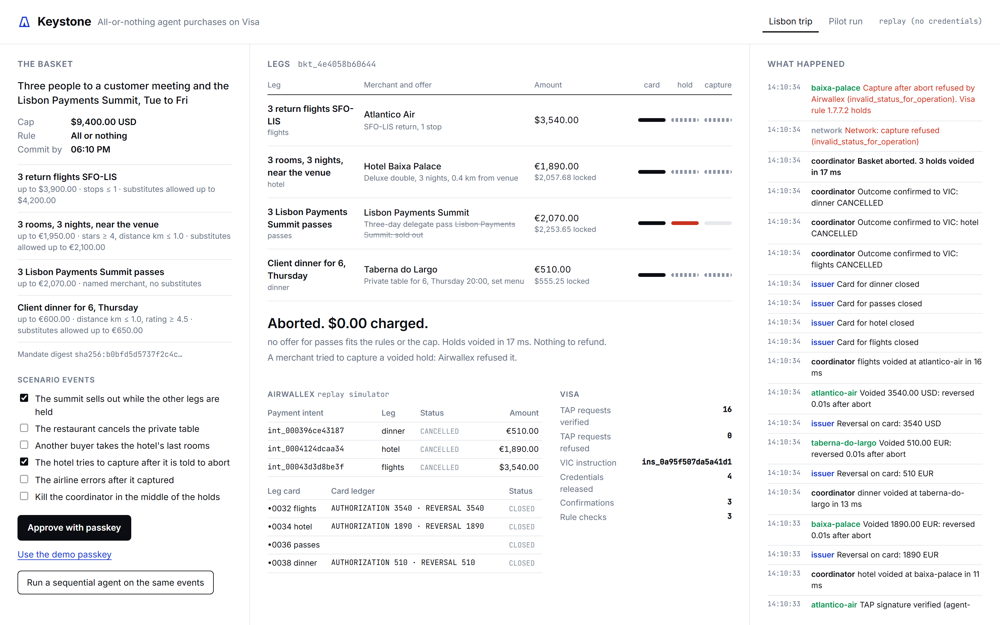
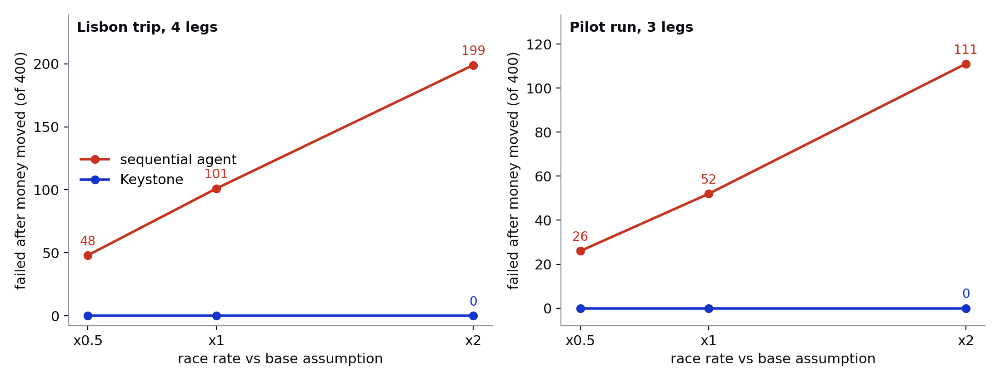

# Keystone

**All-or-nothing agent purchases on Visa.** An agent buying a trip, an event or a bill of materials across several independent merchants gets every piece or pays for none. Keystone holds the card at every merchant first, captures only when every leg is held, and voids the rest in milliseconds when one fails. The buyer is never charged for a partial basket, so there is nothing to refund.

Built on Airwallex Payments (API and the Card Element), Issuing and FX, Visa's Trusted Agent Protocol, and an instruction service shaped on Visa Intelligent Commerce. It runs on the Airwallex sandbox: a four-leg basket held and captured across two currencies, an abort with $0 charged, a coordinator killed mid-basket and recovered, and an escalation approved by passkey ([docs/LIVE_BASKETS.md](docs/LIVE_BASKETS.md)).



*The summit sold out after the hotel, the dinner and the flights were held. Keystone voided the three holds in 18 ms, closed the three leg cards and charged $0.00. The hotel then tried to capture its voided hold, and Airwallex refused.*

## The problem

Every agent payment protocol of 2026 (ACP, UCP, AP2, TAP, x402) describes one checkout at one merchant. Real tasks span merchants. A trip to Lisbon is three flights, three hotel rooms, three summit passes and a client dinner, and each piece is useless without the others. An agent that buys them one after another has already paid for the flights when the summit sells out.

I ran both ways of buying through the same merchants, 400 baskets per scenario, with the same random sell-outs for both agents:

| 400 baskets, base race rate | Sequential agent | Keystone |
|---|---|---|
| Lisbon trip: baskets completed | 299 | 332 |
| Lisbon trip: failed after money moved | 101 | **0** |
| Lisbon trip: paid for non-refundable legs of failed baskets | $630,179 | **$0** |
| Pilot run (chips, boards, screens): failed after money moved | 52 | **0** |
| Pilot run: paid for non-refundable legs | $139,087 | **$0** |

Keystone completes more baskets as well, because a failed leg can be substituted or put to the person while the other legs stay held. The race rates (6% to 18% per leg) are assumptions; the sweep at half and double those rates is in [docs/SIMULATION.md](docs/SIMULATION.md).



## How it works

Card rails already contain a two-phase commit. Keystone uses it.

| Two-phase commit | Card rail | Where in Keystone |
|---|---|---|
| Prepare (vote yes) | Authorization hold, `auto_capture: false` | `keystone/merchant.py` `prepare` |
| Commit | Capture | `merchant.py` `commit` |
| Abort | Void before capture, free | `merchant.py` `abort` |
| Presumed abort if the coordinator disappears | The hold lapses (Visa Core Rules Table 5-12); the merchant voids its own expired reservation | `merchant.py` `sweep`, `coordinator.py` `recover` |
| A participant that cheats after abort | A fully reversed authorization must not be deposited (Visa Core Rules 1.7.7.2) | Airwallex refuses the capture; the evidence shows it |

1. **One approval for the whole basket.** The person approves the legs, each leg's rules, a cap in home currency and "all or nothing" with a passkey. The WebAuthn challenge is the SHA-256 digest of the canonical mandate, so a changed term needs a new approval. The approval opens an instruction shaped on Visa Intelligent Commerce: one mandate per leg, with its decline threshold and expiry.
2. **Plan and lock.** The agent browses each merchant's catalog with a TAP-signed request (`agent-browser-auth`), keeps only offers the rules allow, and takes an Airwallex FX quote per foreign leg whose validity covers the commit window. The home-currency total must fit the cap.
3. **One Airwallex Visa card per leg.** Single use, locked to the leg's currency and merchant category, limited to the leg's ceiling, active until the commit deadline. Its credential is released by the instruction service only inside that leg's mandate.
4. **Prepare, scarcest first.** Each merchant gets a TAP-signed `agent-payer-auth` request whose body (basket, leg, offer, amount, mandate digest, deadline) is covered by a Content-Digest. The merchant reserves stock, places the hold on an Airwallex payment intent and answers with a signed hold receipt. Every authorization on a leg card goes through the issuer's basket ledger, an Airwallex remote-authorization endpoint that declines a second hold on a leg, a hold past the basket cap, and any hold on a closed basket.
5. **Decide when a leg fails.** Substitute inside the rules and keep the other holds; or put priced options to the person, who approves one with a passkey over that option's amendment; or abort.
6. **Commit or abort.** The decision is written to a durable log before any merchant hears it. Commit converts at the locked quotes and captures the most fragile hold first. Abort voids every hold at once. Every card is closed either way, and each outcome is reported to the instruction service.

A model can rank the offers the rules already allow and write the explanation the person reads (`keystone/advisor.py`: Gemini on Vertex AI, Claude, or a Bedrock model; off unless configured). It orders offers only within a group, so an offer that fits the leg as written always comes before a substitute. Amounts, rules and decisions are code.

## Run it

Replay mode needs no credentials. The Airwallex calls go through the same REST client to a local simulator that serves the same paths and JSON shapes.

```
uv venv .venv --python 3.11
uv pip install --python .venv -e ".[dev]"
.venv/Scripts/python -m keystone.serve        # bin/python on macOS and Linux
```

Open http://localhost:8000, choose the scenario events to inject, and approve with a passkey on your device (or the demo passkey). Then:

```
.venv/Scripts/python -m pytest                 # 48 tests; every flow runs on the fake and through the REST client
.venv/Scripts/python -m keystone.evidence      # 16 fault and rules cases -> docs/EVIDENCE.md
.venv/Scripts/python -m keystone.sim --n 400 --sweep   # the basket simulation
```

**Airwallex sandbox.** Sign up at sandbox.airwallex.com and copy the Client ID and API key from Account > Developer > API keys (allowlist your public IP there). Live mode places each hold through Airwallex's Card Element in a headless browser, so it needs Chromium.

```
uv pip install --python .venv -e ".[live]"
.venv/Scripts/python -m playwright install chromium
set AWX_CLIENT_ID=...
set AWX_API_KEY=...
.venv/Scripts/python scripts/live_probe.py     # every Airwallex behaviour Keystone relies on -> docs/LIVE_SANDBOX.md
set KEYSTONE_MODE=live
.venv/Scripts/python -m keystone.serve
```

**Visa's own TAP registry.** `scripts/visa_registry.py setup | run | register` fetches Visa's sample agent-registry from GitHub, runs it, and registers Keystone's Ed25519 key. Start Keystone with `KEYSTONE_REGISTRY_URL=http://127.0.0.1:9002` and every merchant looks the agent's key up there. `deactivate` is the revocation demo.

**Model advisor.** `KEYSTONE_ADVISOR=gemini` with `GOOGLE_CLOUD_PROJECT` uses Gemini 3.8 Flash on Vertex AI (install `.[gemini]`, `gcloud auth application-default login`); the live escalation in [LIVE_BASKETS.md](docs/LIVE_BASKETS.md) ran with it. `KEYSTONE_ADVISOR=1` with `ANTHROPIC_API_KEY` uses Claude; `KEYSTONE_ADVISOR=bedrock` uses a Bedrock model through the Converse API (`KEYSTONE_BEDROCK_MODEL`, `AWS_PROFILE`; install `.[bedrock]`). Without one, the rule-written explanation is shown.

## Judge map

| Requirement | Where |
|---|---|
| Uses Airwallex APIs | Payment intents (create, hold through Airwallex.js Card Element with `autoCapture: false` or `pre_auth`, capture, cancel, refunds), Issuing (cardholder, cards with authorization controls, card details, update, simulation of authorize, capture, reverse, refund, transactions), FX (quotes with validity, conversions with `quote_id`, rates), balances, remote-authorization contract. All calls in `keystone/airwallex/client.py`, listed in [docs/AIRWALLEX_CALLS.md](docs/AIRWALLEX_CALLS.md) |
| Uses Visa tooling | Trusted Agent Protocol: RFC 9421 Ed25519 signatures with the `agent-browser-auth` and `agent-payer-auth` tags on every merchant call (`keystone/tap.py`), interop with Visa's sample agent-registry and its request format. Visa Intelligent Commerce: instruction, credentials, amendments and confirmations shaped on the CyberSource guide (`keystone/vic.py`). Visa Core Rules checked in code (`keystone/rules.py`). See [docs/VISA.md](docs/VISA.md) |
| A financial decision that changes with the facts | Substitute, escalate or abort when a leg fails, inside a cap that holds across currencies at locked rates |
| Approvals bound to exact terms | Passkey assertion over the mandate digest; a second assertion over each amendment |
| Amounts and state in code | Decimal money, typed mandate, rule checks, durable log; the model only orders offers and writes text |
| Ends on a money movement or an escalation | Four captures, or voids with $0 charged, or a priced escalation on the person's phone |
| Working demo, setup instructions | `python -m keystone.serve`, this README |

## What is real and what stands in

| Part | Status |
|---|---|
| Airwallex REST client | Runs against the sandbox: 20 of 20 probe steps as expected ([LIVE_SANDBOX.md](docs/LIVE_SANDBOX.md)) and four full baskets ([LIVE_BASKETS.md](docs/LIVE_BASKETS.md)) |
| Hold placement in live mode | The agent's TAP-signed headless browser types the card into Airwallex's Card Element on the merchant's checkout page (`keystone/checkout.py`); server-side card entry needs PCI-DSS enablement this account does not have |
| Airwallex replay simulator | Mine. Same paths and JSON as the subset Keystone calls, documented sandbox behaviour (one capture, never above the hold, cancel to CANCELLED, request_id rules, card-control decline reasons) |
| Visa network between acquiring and issuing | A bridge in `keystone/network.py`. Airwallex's sandbox acquirer rejects Airwallex-issued card numbers ("invalid pan"), so the two sides do not connect there. The bridge sends each authorization to the leg card first (issuing simulation by `card_id`, decided by the basket ledger) and the payment intent is held with Airwallex's test card; captures and voids are mirrored on both sides |
| Issuer remote authorization | The endpoint follows Airwallex's v2 contract (x-nonce, HMAC, echoed event id). The simulator calls it the way Airwallex does; in live mode the call is relayed until remote auth is enabled on the account |
| TAP | The protocol as specified, with Visa's sample registry as the key directory option |
| Visa Intelligent Commerce | A stand-in with the published field names. VIC is pilot-gated; the service is behind one interface so the real one can replace it |
| Merchants, offers, the summit | Fictional |

## Repo

```
keystone/
  tap.py            RFC 9421 signing and verification, key directory clients
  merchant.py       merchant service: catalog, prepare, commit, abort, refund, signed receipts
  coordinator.py    two-phase commit across merchants, decisions, recovery
  journal.py        durable SQLite log
  issuer.py         per-leg cards and the basket ledger
  network.py        acquirer-issuer bridge
  vic.py            instruction service shaped on Visa Intelligent Commerce
  passkey.py        WebAuthn approvals bound to digests; software authenticator for tests
  rules.py          Visa rules checks
  airwallex/        REST client, in-memory fake, replay simulator
  sequential.py     the baseline agent
  sim.py            basket simulation
  evidence.py       fault-injection cases
  app.py, world_server.py, serve.py, web/   the two processes and the console
scripts/            live sandbox probe, Visa registry, headless console driver, figures
docs/               evidence, simulation, Airwallex calls, Visa notes, screenshots
```

## Licence

MIT, see [LICENSE](LICENSE). Visa's TAP sample is not included; `scripts/visa_registry.py` fetches it from GitHub under Visa's own terms.
