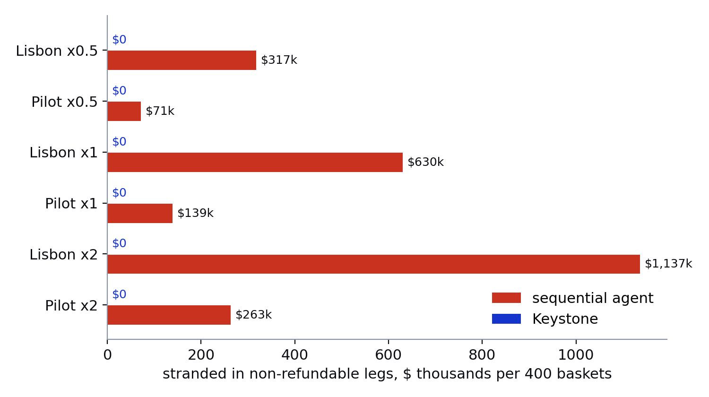

# Basket simulation

`python -m keystone.sim --n 400 --seed 7 --sweep` runs the real coordinator, merchants, issuer ledger and the Airwallex replay for 400 baskets per scenario and per race rate, once with Keystone and once with a sequential agent. Both agents see the same draws: which offers another buyer takes at the moment the agent tries to buy, and how the person answers an escalation.

## Assumptions

| | |
|---|---|
| Race probability per leg at x1 | flight 0.06, hotel 0.18, event 0.1, restaurant 0.15, component 0.12 |
| Escalation answer | the person approves the cheapest option with probability 0.6, otherwise declines |
| Refund delay | 9 days (US DOT: card refunds within 7 business days for cancelled flights) |
| FX | replay spread 0.25% per conversion each way; spot moves by up to 0.4% over a day |
| Refundability | from the scenario: flights, the Baixa hotel, the summit, the chip reel, both board makers and the first display maker are non-refundable |

Everything else is measured from what the code did.

## Results

| Scenario | Race | Agent | Completed | Failed after money moved | Stranded (non-refundable) | Refunds needed | FX lost on refunds | Escalations | Voids |
|---|---|---|---|---|---|---|---|---|---|
| hardware | x0.5 | sequential | 374/400 | 26 | $71,438.65 | 1 | $0.00 | 0 | 0 |
| hardware | x0.5 | keystone | 374/400 | 0 | $0.00 | 0 | $0.00 | 0 | 2 |
| lisbon | x0.5 | sequential | 352/400 | 48 | $317,297.16 | 4 | $2.78 | 0 | 0 |
| lisbon | x0.5 | keystone | 369/400 | 0 | $0.00 | 0 | $0.00 | 30 | 58 |
| hardware | x1 | sequential | 345/400 | 52 | $139,087.49 | 3 | $0.00 | 0 | 0 |
| hardware | x1 | keystone | 345/400 | 0 | $0.00 | 0 | $0.00 | 0 | 8 |
| lisbon | x1 | sequential | 299/400 | 101 | $630,179.18 | 17 | $6.46 | 0 | 0 |
| lisbon | x1 | keystone | 332/400 | 0 | $0.00 | 0 | $0.00 | 75 | 103 |
| hardware | x2 | sequential | 270/400 | 111 | $262,572.25 | 20 | $0.00 | 0 | 0 |
| hardware | x2 | keystone | 270/400 | 0 | $0.00 | 0 | $0.00 | 0 | 44 |
| lisbon | x2 | sequential | 196/400 | 199 | $1,136,774.60 | 41 | $2.85 | 0 | 0 |
| lisbon | x2 | keystone | 266/400 | 0 | $0.00 | 0 | $0.00 | 193 | 188 |

Errors: 0 in every run.

Reading it: the sequential agent pays each leg before it looks at the next, so a later failure leaves paid legs behind. Most of those legs are non-refundable, which is where the stranded money comes from; the refundable ones come back after the refund delay and, for euro legs, at a different rate. Keystone holds and voids instead of paying and refunding, so no failed basket moves money. It also completes more Lisbon baskets, because a failed leg is substituted or put to the person while the other legs are still held. In the pilot run both agents complete the same baskets, since both substitute the same way and the person is never asked there.

